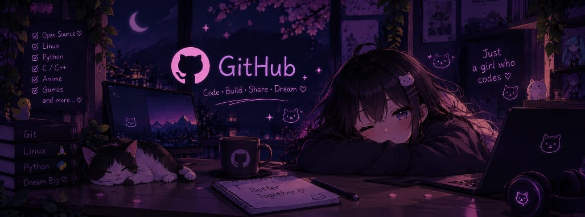

<div align="center">


<sub><a href="#user-content-about">about</a>　·　<a href="#user-content-work">work</a>　·　<a href="#user-content-now">now</a>　·　<a href="#user-content-roadmap">roadmap</a>　·　<a href="#user-content-stack">stack</a>　·　<a href="#user-content-numbers">numbers</a>　·　<a href="#user-content-questions">questions</a></sub>

</div>

## About

<sub>a short version, no pitch deck</sub>

I build small software on purpose. Not because big things are wrong, but because a
small thing can be finished, explained, and trusted by the person using it.

Six projects live here. Each does one job, keeps its dependencies short, and still
runs with the network unplugged. The documentation describes what works today, not
what I hope will work next month. When something is unfinished, the README says so.

```python
me = {
    "alias": "Dev2Creator",
    "craft": ["Python", "AI", "game engines", "developer tools"],
    "belief": "a small tool that solves one problem well beats a big one that solves none",
    "motto": "Imagine. Build. Experiment.",
    "status": "shipping in public, one honest release at a time",
}
```

## Work

<sub>six projects · each with a reason to exist</sub>

| Project | What it is, and why it exists |
| :--- | :--- |
| 🎮 [**py3dgame**](https://github.com/Dev2Creator/py3dgame) | Python-native game library: window, fixed-timestep loop, input, scene graph, software 2D renderer, 55 tests. Built to understand a renderer from the inside. |
| 🌱 [**IRL-**](https://github.com/Dev2Creator/IRL-) | Universal package installer and developer tool ecosystem, at v2.1.0. Installing software should not require reading a wiki first. |
| 🌸 [**TransPower**](https://github.com/Dev2Creator/TransPower-v1.7) | Offline-first AI companion running a quantised ONNX model locally. Useful software without shipping your conversations to a server. |
| 🐈 [**cutie-os**](https://github.com/Dev2Creator/cutie-os) | A terminal environment with better manners. The shell is where the day starts, so it should be a kind place. |
| 🗿 [**IRL-WISDOM**](https://github.com/Dev2Creator/IRL-WISDOM) | A small CLI that prints one useful thought before you begin. Perspective, delivered without a dashboard. |
| 🦋 [**irl-besty**](https://github.com/Dev2Creator/irl-besty) | Password-seeded emoji cipher and a deliberately chaotic toolchain. Security can be playful without being unserious. |

<details>
<summary><b>The flagship, in detail</b> — py3dgame</summary>

<br />

The engine is the project I am slowest about, because a renderer is only worth
having if you understand every stage of it. The public repository currently
contains the parts that genuinely work:

- a window and a fixed-timestep loop, so updates are reproducible
- an input layer and a scene graph with parent/child transforms
- a software 2D renderer, with **55 tests** covering the maths and the pipeline

It is not a finished 3D engine, and the README of the project says so. The next
stages are public in the roadmap below rather than promised in the description.

</details>

## Now

<sub>this week, honestly</sub>

- **py3dgame:** hardening the tests around the renderer, then the 3D stage of the pipeline.
- **Practising:** shadow mapping and tone mapping on small scenes, the unglamorous parts that make an engine feel real.
- **Reading:** whatever explains an algorithm better than I could, then writing my own version of it.
- **Not doing:** adding features faster than I can document them.

## Roadmap

<sub>status is stated, never implied</sub>

| Stage | Status |
| :--- | :--- |
| py3dgame: window, loop, input, scene graph, 2D renderer, 55 tests | **shipped in the repo** |
| py3dgame: maths, cameras, 3D geometry pipeline | **in development** |
| py3dgame: rasteriser, materials, lighting, shadows | planned |
| Scene documents that round-trip through JSON, plus a preview server | planned |
| An editor for those scene documents | planned |

## Stack

<sub>what I actually reach for, in words rather than a badge wall</sub>

- **Languages:** Python first, then C and C++ when something needs to be close to the metal, with TypeScript and JavaScript for the web side.
- **Python tooling:** pytest for everything, `venv` and pinned requirements, packaging through PyPI.
- **Graphics and AI:** software rendering in plain Python, Three.js when it has to be in a browser, ONNX for local models.
- **Everyday:** Linux, Git, a terminal, and a text editor with too many tabs open.

## Numbers

<sub>verifiable only, with the source and the period</sub>

| Figure | What it means |
| :--- | :--- |
| **51,604** | PyPI downloads across the published packages from 1 June to 7 November 2026 (pypistats) |
| **5,451** | of those on `irlxleet` alone, same period |
| **1,128** | npm downloads for `irlxleet` since it was published in July 2026 (npm registry) |
| **6** | featured projects on this page, which is not the same as the total public repository count |
| **0** | accounts, telemetry endpoints, or "sign in to continue" |

## Questions

<sub>the three I am asked most, answered properly</sub>

<details>
<summary><b>Why many small tools instead of one large application?</b></summary>

<br />

Because small tools get finished. A tool with one job can be documented, tested and
trusted in a weekend, and it still runs three years later. A large application turns
into a roadmap that nobody reads, including its author.

</details>

<details>
<summary><b>What does offline-first actually mean here?</b></summary>

<br />

The core work happens on your machine, with no account and no telemetry, and the
tools keep working when the network is gone. It does not mean every optional feature
is air-gapped: anything that fetches data from the internet is described as doing so,
in the repository's own README rather than in a slogan.

</details>

<details>
<summary><b>Can I use this code in my own project?</b></summary>

<br />

Yes. Each repository carries its own licence (most are AGPL-3.0, so check the file
before you ship). If you build something with it, open an issue with a link, because
that is genuinely the best part of writing software in public.

</details>

## Principles

<sub>polite to machines, kind to people</sub>

- **Small tools.** One job per repository, and the smallest dependency list that will do it.
- **Honest documentation.** If a feature is unfinished, the README says unfinished. Docs describe the code that exists.
- **Understandable engineering.** Cleverness is a cost. The next reader is usually me in six months.
- **Useful software.** No account walls, no telemetry, no dark patterns, no feature that exists only for a screenshot.
- **Little promises.** Bug reports get answers. Releases get notes. Numbers get sources.
- **Build in public.** The commits, the tests and the mistakes are all visible, in that order.

<details>
<summary><b>Little rituals</b> — the habits behind the tidy parts</summary>

<br />

1. Write the test before the demo, so the demo can be repeated.
2. Commit in small pieces; a messy history is a hard week.
3. One repository, one job. A second purpose deserves a second repository.
4. Answer the issue before adding the feature. Someone waited on that.
5. Finish the docs for what exists before dreaming about what does not.

</details>

---

<div align="center">




<sub>the desk behind all of this — purple light, one sleeping cat, slightly too much tea</sub>

**Thanks for reading this far.**

<sub>If a tool here saved you an afternoon, a star is a quiet thank you. If something is broken, an issue is a kindness.</sub>

<sub><a href="https://github.com/Dev2Creator">github.com/Dev2Creator</a>　·　<a href="https://dev2creator-portfolio.vercel.app/">portfolio</a>　·　<a href="https://pypi.org/project/irlxleet/">pypi</a>　·　<a href="#user-content-questions">questions</a></sub>

</div>
