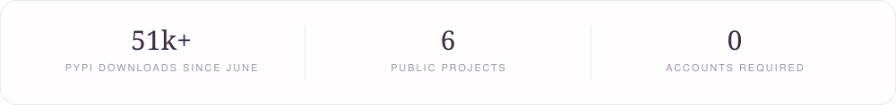
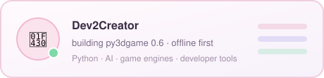

<div align="center">


<a href="#user-content-about"><code>about</code></a>　·　<a href="#user-content-work"><code>work</code></a>　·　<a href="#user-content-now"><code>now</code></a>　·　<a href="#user-content-roadmap"><code>roadmap</code></a>　·　<a href="#user-content-stack"><code>stack</code></a>　·　<a href="#user-content-numbers"><code>numbers</code></a>　·　<a href="#user-content-questions"><code>questions</code></a>

</div>

<table>
<tr>
<td align="center" width="26%" valign="middle">

<br /><br />

</td>
<td align="left" valign="middle">
<h3 id="top">Dev2Creator</h3>
<p><i>I turn quiet "what if" ideas into small things that work.</i></p>
<p><sub>Python · AI · game engines · developer tools — built offline first, documented honestly.</sub></p>
<p>
<a href="https://github.com/Dev2Creator"></a>
<a href="https://dev2creator-portfolio.vercel.app/"></a>
</p>
<p>
<a href="https://pypi.org/project/irlxleet/"></a>
<a href="https://pypi.org/project/irlxleet/"></a>
<a href="https://www.npmjs.com/package/irlxleet"></a>
</p>
</td>
</tr>
</table>



<sub align="center">numbers with sources, not screenshots of dashboards 🌷</sub>


## About

<sub>a short version, no pitch deck</sub>

I build small software on purpose. Not because big things are wrong, but because
small things can be finished, explained, and trusted by the person using them.

Six projects live here. Each one does a single job, ships with tests and docs that
match the code, and keeps working with the network unplugged. Nothing asks you to
make an account. Nothing phones home.

```python
me = {
    "alias": "Dev2Creator",
    "craft": ["Python", "AI", "game engines", "developer tools"],
    "belief": "a small tool that solves one problem well beats a big one that solves none",
    "motto": "Imagine. Build. Experiment.",
    "status": "shipping in public, one release at a time",
}
```

## Work

<sub>six projects · tap a card for the honest version · the bunny supervises 🐰</sub>

| Project | What it does | Why it exists |
| :--- | :--- | :--- |
| 🌱 [IRL-](https://github.com/Dev2Creator/IRL-) | Universal package installer | installing things should not need a wiki page |
| 🐈 [cutie-os](https://github.com/Dev2Creator/cutie-os) | Wholesome terminal environment | the terminal can be a kind place |
| 🎮 [py3dgame](https://github.com/Dev2Creator/py3dgame) | 3D game development in Python | to actually understand how a renderer works |
| 🗿 [IRL-WISDOM](https://github.com/Dev2Creator/IRL-WISDOM) | Wisdom-powered terminal CLI | a small nudge before the day starts |
| 🦋 [irl-besty](https://github.com/Dev2Creator/irl-besty) | Password-seeded emoji cipher | encryption that is fun to look at |
| 🌸 [TransPower](https://github.com/Dev2Creator/TransPower-v1.7) | Offline AI companion | useful software without shipping your life to a server |

<details>
<summary><b>py3dgame</b> — the software renderer &nbsp;<sub>flagship</sub></summary>

<br />

Camera, geometry pipeline and rasteriser written in plain Python, so nothing hides
behind a graphics driver. Scene documents round-trip through JSON. A preview server
shows the frame while you edit.

- **0.6 today:** software rasteriser, scene documents, preview server, optional provider-neutral AI runtime
- **Next:** shadow maps, texture pipeline, tone mapping
- **Rule:** if it is not finished, it is not in the docs

</details>

<details>
<summary><b>TransPower</b> — offline, on purpose</summary>

<br />

A local AI companion with a quantised ONNX model (SmolLM-135M) and a warm
personality. Runs on your machine, without an account, a key, or an upload.

</details>

<details>
<summary><b>irl-besty</b> — a cipher you can look at</summary>

<br />

Password-seeded emoji encryption: the same password always unlocks the same biome
of characters, so output stays stable, reversible, and oddly pretty.

</details>

<details>
<summary><b>cutie-os · IRL-WISDOM · IRL-</b> — the terminal trio</summary>

<br />

- **cutie-os** makes a shell feel like a kind room.
- **IRL-WISDOM** prints one useful thought before the day starts.
- **IRL-** installs things without sending you off to read a wiki.

</details>


## Now

<sub>the state of things this week</sub>



- **Building** py3dgame, a Python 3D engine with a software rasteriser, scene documents, a preview server, and an optional provider-neutral AI runtime.
- **Going deeper into** shadow mapping, tone mapping and world streaming — the quiet parts that make an engine feel real.
- **Believing** offline first. Anything here should still work with the network unplugged.

## Roadmap

<sub>checked means shipped</sub>



- [x] **py3dgame 0.6** — software rasteriser, scene documents, preview server
- [ ] **py3dgame 0.7** — shadow maps, texture pipeline, tone mapping
- [ ] An editor for engine-native scene documents
- [ ] One small terminal tool each month, because small things ship

## Stack

<sub>what I actually reach for</sub>

<details>
<summary><b>Languages, tooling and test gear</b></summary>

<br />

**Languages**


**Web, tooling, tests**


</details>

## Numbers

<sub>measured, not estimated</sub>

| Number | What it counts |
| :--- | :--- |
| **51k+** | PyPI downloads across the published packages since June |
| **5.4k** | of those on `irlxleet` alone |
| **1.1k** | npm downloads for the same tool |
| **6** | public projects, each with its own reason to exist |
| **0** | accounts, telemetry endpoints, or "sign in to continue" |


## Questions

<sub>the three I get most, answered properly</sub>

<details>
<summary><b>Why so many small tools instead of one big app?</b></summary>

<br />

Because small tools get finished. A tool with one job can be documented, tested and
trusted in a weekend, and it still works three years later. A big app usually turns
into a roadmap nobody reads.

</details>

<details>
<summary><b>Does anything here need an account or a server?</b></summary>

<br />

No. Everything is local-first and works with the network unplugged. There is no
telemetry, no sign-in, and no remote call that decides whether the tool runs.

</details>

<details>
<summary><b>Can I use this code in my own project?</b></summary>

<br />

Yes, the licences are in each repository. If you build something with it, I would
genuinely like to see it, so open an issue with a link.

</details>

## Principles

<sub>the rules I actually keep</sub>

<details>
<summary><b>Little rituals</b> &nbsp;<sub>the boring habits that make the cute stuff possible</sub></summary>

<br />

- Write the test before the demo, so the demo can be repeated.
- Commit in small pieces; a messy history is a hard week.
- One repository, one job. If it needs a second purpose, it needs a second repo.
- Answer the issue before adding the feature. Someone waited on that.
- Finish the docs for what exists before dreaming about what does not.

</details>

<details>
<summary><b>Five opinions, no hedging</b></summary>

<br />

| About | My take |
| :--- | :--- |
| Frameworks | learn the primitives first, the framework will still be there later |
| Dependencies | every one of them is a promise someone else has to keep |
| Documentation | if it is not written down, it does not exist |
| Speed | measure before optimising, then measure again |
| Tests | the test is the part of the project that survives |

</details>

<details>
<summary><b>Little promises</b></summary>

<br />

1. No telemetry, no account, no "sign in to continue".
2. Docs describe what already works, never what I hope will.
3. Small dependencies, pinned and explained.
4. If a release breaks you, an issue gets an answer, not silence.

</details>

<details>
<summary><b>Why everything stays small</b></summary>

<br />

Big projects fail quietly: the README promises, the code does not. Small projects
fail loudly, and loud failures can be fixed.

So each repository here does one thing, documents exactly what works, and says
plainly what does not. If a feature is not done, it is not in the docs. That rule
is boring, and it is the only reason these projects still run a year later.

</details>

<details>
<summary><b>🐰 pet the bunny</b> &nbsp;<sub>go on, he is very soft</sub></summary>

<br />

<div align="center">

*he wiggled his ears. thank you.* 🌸

</div>

</details>

<details>
<summary><b>🕹️ a tiny guessing game</b> &nbsp;<sub>three questions, answers hidden one click deeper</sub></summary>

<br />

**1. Which project renders 3D in pure Python, no GPU?**

<details>
<summary>reveal the answer</summary>

<br />

py3dgame — a software rasteriser written from scratch, 0.6 released.

</details>

**2. Which tool turns a password into a field of emoji?**

<details>
<summary>reveal the answer</summary>

<br />

irl-besty — the same password always unlocks the same biome.

</details>

**3. Which one runs a small language model on your own laptop?**

<details>
<summary>reveal the answer</summary>

<br />

TransPower — a quantised ONNX SmolLM-135M, offline.

</details>

</details>

<details>
<summary><b>🎁 psst — a small easter egg</b></summary>

<br />

You found it. The bunny was only pretending to work.

Run `python tools_make_bunny.py` and he hops again: 20 frames, no dependencies,
every frame drawn by hand in this repository.

🌸 *Thanks for being curious. That is the whole hobby.* 🌸

</details>


<div align="center">

### Thanks for visiting

<sub>if a build saved you an afternoon, a ⭐ is a quiet high-five</sub>


<sub>the desk behind all of this — purple light, one sleeping cat, slightly too much tea 🐈‍⬛</sub>

<sub><i>come back any time. the bunny keeps hopping, the kettle is always warm.</i></sub>

<sub><a href="#user-content-top">back to the top</a></sub>

</div>
