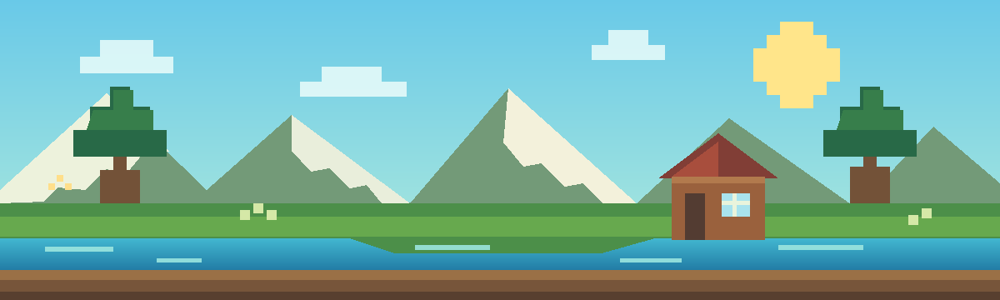

<div align="center">


<a href="https://github.com/Dev2Creator"></a>

### ✨ a tiny corner of the internet, built with big dreams ✨

*I turn little “what if?” ideas into things you can play with, learn from, and use.*

<a href="#-spawn-point">🌷 about</a>　·　<a href="#-things-ive-crafted">🧸 projects</a>　·　<a href="#-current-quest">🗺️ quest</a>　·　<a href="#-my-little-toolbox">🎀 toolbox</a>　·　<a href="#-thanks-for-visiting">💌 say hi</a>

</div>

<table>
<tr>
<td align="center" valign="middle" width="30%">



### 🐰 a note from the bunny



<sub>🌸 little words, lots of love 🌸</sub>

<sub><i>polite to machines · kind to people</i></sub>

</td>
<td align="center" valign="middle">



## ⛏️ Dev2Creator

**Builder of little things with big “what if?” energy.**

`PYTHON`　`AI`　`GAME ENGINES`　`DEV TOOLS`

<a href="https://github.com/Dev2Creator"></a>
<a href="https://dev2creator-portfolio.vercel.app/"></a>

<a href="https://pypi.org/project/irlxleet/"></a>
<a href="https://pypi.org/project/irlxleet/"></a>
<a href="https://www.npmjs.com/package/irlxleet"></a>

🌱 **Imagine · Build · Experiment · Repeat** 🌱

</td>
</tr>
</table>

<div align="center">


</div>

## 🌷 Spawn point

Hey, I’m **Dev2Creator**! I love taking an idea from *“wouldn’t it be cool if…”* to a small, working thing you can actually use. Around here you’ll find carefully crafted builds, readable code, playful experiments, and lots of curiosity. ☁️

```text
╭─────────────── ✿ little player card ✿ ───────────────╮
│  name       Dev2Creator                              │
│  class      builder · tinkerer · curious human       │
│  favorite   Python · AI · game engines · dev tools    │
│  play style imagine → build → experiment → repeat    │
│  current XP shipping small things with love          │
╰───────���───────────────────────────────────────────────╯
```

> 🌼 **My build rule:** one useful thing, built well, beats a giant pile of unfinished blocks. Start small, test early, keep it readable, and write down what actually works.

## 🧸 Things I’ve crafted

*A few little projects, each with its own reason to exist.*

| 🌟 Build | 🧁 What it does | 💭 Why I made it |
| :--- | :--- | :--- |
| 🌱 [**IRL-**](https://github.com/Dev2Creator/IRL-) | Universal package installer | Installing things shouldn’t need a wiki quest. |
| 🐈 [**cutie-os**](https://github.com/Dev2Creator/cutie-os) | Wholesome terminal environment | The terminal can be a kind place. |
| 🎮 [**py3dgame**](https://github.com/Dev2Creator/py3dgame) | Python-native game library: window, fixed-timestep loop, input, scene graph, software 2D renderer, **55 tests** | I wanted to understand how a renderer works, block by block. The 3D stages come after the 2D one is boring and reliable. |
| 🗿 [**IRL-WISDOM**](https://github.com/Dev2Creator/IRL-WISDOM) | Wisdom-powered terminal CLI | A tiny bit of perspective before the day’s adventure. |
| 🦋 [**irl-besty**](https://github.com/Dev2Creator/irl-besty) | Password-seeded emoji cipher | Security can be playful *and* useful. |
| 🌸 [**TransPower**](https://github.com/Dev2Creator/TransPower-v1.7) | Offline AI companion | Useful software, without shipping your life to a server. |

## 🗺️ Current quest

- **Main quest:** building **py3dgame**. Working today: the window, the fixed-timestep loop, input, a scene graph, and a software 2D renderer with 55 tests. The 3D pipeline is the next block, and the README of that repo says exactly where it stops.
- **Next blocks:** shadow mapping, a real texture pipeline, and tone mapping—the behind-the-scenes details that make a world feel real.
- **Big dream:** a scene editor that edits the same JSON the engine already loads.
- **World setting:** offline-first. My projects should still work when the internet portal is closed. 🌙

### 📜 Quest log

- [x] **py3dgame** — window, fixed-timestep loop, input, scene graph, software 2D renderer, 55 tests
- [ ] **py3dgame** — maths, cameras and the 3D geometry pipeline *(in development)*
- [ ] **py3dgame** — rasteriser, materials, lighting and shadow maps *(planned)*
- [ ] Build an editor for engine-native scene documents
- [ ] Ship one small terminal tool each month; little builds deserve to leave the crafting table

## 🎀 My little toolbox

<details>
<summary><b>Open the toolbox</b> — languages, tools & useful blocks ✨</summary>

<br />

**Languages**


**Web, tools & test gear**


</details>

## 🪄 The little rules behind my builds

<details>
<summary><b>My redstone rules</b> — tiny principles, big difference 💖</summary>

<br />

| 🌟 Rule | 💌 Why it matters |
| :--- | :--- |
| Learn the primitives before adding a framework. | The framework will still be there after you understand the blocks. |
| Every dependency is a promise. | Keep the dependency chest small, pinned, and explained. |
| If it isn’t documented, it’s a rumor. | Docs should describe what works—not the feature we wish existed. |
| Measure before optimising. | Then measure again; vibes are not a benchmark. |
| Tests are part of the build. | They help the project survive its next adventure. |
| No telemetry, accounts, or “sign in to continue.” | Your tools should belong to you. |

</details>

<div align="center" id="thanks-for-visiting">


## 💌 Thanks for visiting my little corner!

If a build saved you an afternoon, a ⭐ is a lovely little high-five. If you have an idea, question, or kind hello, my [portfolio](https://dev2creator-portfolio.vercel.app/) is always open. 🌷

**Stay curious. Keep crafting. Be kind to yourself.** 🩷

<sub>Fan-made profile styling inspired by block-building games; not affiliated with or endorsed by Mojang or Microsoft.</sub>

</div>
